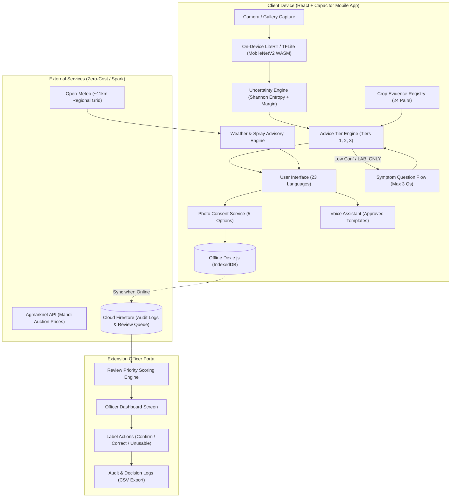

# THINAI System Architecture

## 1. Overview & Core Mission

THINAI (**T**echnology for **H**olistic **I**ntelligent **N**urturing of **A**gricultural **I**ntelligence) is an offline-first mobile operating system and decision support tool for smallholder farmers and agricultural extension officers across India, with deep localization for Tamil Nadu agrarian conditions.

The system is built on an audited safety principle:
**Never provide automated chemical pesticide recommendations unless the crop-disease pair is field-validated on real-world Indian agricultural imagery, confirmed by human agronomic review, and passes confidence and uncertainty safety gates.**

---

## 2. High-Level System Architecture



---

## 3. Data Flow & Advisory Pipeline

The diagnosis flow follows a strict 6-stage pipeline:

```mermaid
sequenceDiagram
    autonumber
    actor Farmer as Farmer
    participant App as THINAI App (Offline)
    participant Model as LiteRT Engine
    participant Uncertainty as Uncertainty Service
    participant Policy as Advice Tier Engine
    participant Consent as Privacy Consent Service
    participant Officer as Officer Queue (Cloud / Local)

    Farmer->>App: Captures leaf photograph & selects crop
    App->>Model: Preprocessed image (224x224 RGB normalized)
    Model->>App: Raw logits & Top-3 softmax predictions
    App->>Uncertainty: Calculate Shannon Entropy & Margin Uncertainty
    Uncertainty-->>App: Uncertainty Score (0.0 to 1.0) & Demotion Flags
    App->>Policy: Crop, Disease, Calibrated Confidence, Uncertainty
    Policy->>Policy: Query cropEvidenceRegistry.json & advicePolicy.ts
    alt Evidence is UNSUPPORTED or Uncertainty is HIGH
        Policy-->>App: Assign Tier 3 (Inconclusive / Officer Referral)
    else Evidence is LAB_ONLY
        Policy-->>App: Cap at Tier 2 (Cultural Sanitation Only; Chemical Withheld)
        App->>Farmer: Prompt Symptom Question Flow (Optional, Max 3 Qs)
    else Evidence is FIELD_VALIDATED and Conf >= 0.78
        Policy-->>App: Allow Tier 1 (Bio-rational & TNAU/ICAR vetted advice)
    end
    App->>Farmer: Render Diagnosis Card & Voice Prompt
    Farmer->>App: Clicks "Request Extension Officer Review"
    App->>Consent: Present Photo Sharing Consent (Full / Cropped / Blurred / Metadata)
    Farmer->>Consent: Selects consent option & GPS opt-in
    Consent->>Officer: Enqueue case with Priority Score w1..w5
```

---

## 4. Architectural Modules

### 4.1 On-Device LiteRT Inference & Uncertainty Assessment
- **Module**: `src/services/litertInferenceService.ts`, `src/services/uncertaintyService.ts`
- **Model**: MobileNetV2 quantized LiteRT model running locally via WebAssembly with zero network dependency.
- **Uncertainty Quantification**:
  - **Normalized Shannon Entropy**:
    $$H_n(p) = -\frac{1}{\ln(K)} \sum_{k=1}^K p_k \ln(p_k)$$
  - **Margin Uncertainty**:
    $$M(p) = 1.0 - (p_{(1)} - p_{(2)})$$
  - **Combined Uncertainty**:
    $$U = 0.5 \cdot H_n + 0.5 \cdot M$$
  - If $U > 0.65$ or margin $< 0.15$, the diagnosis is automatically demoted to Tier 3 regardless of top-1 probability.

### 4.2 Evidence-Graded Registry & Decision Policy
- **Registry**: `src/data/cropEvidenceRegistry.json` (24 crop-disease entries)
- **Policy**: `src/config/advicePolicy.ts`, `src/services/evidenceTierEngine.ts`
- **Evidence Levels**:
  - `FIELD_VALIDATED`: Tested on $\ge 50$ real-world field images with $\text{ECE} \le 0.15$. Currently withheld (`ALLOW_CHEMICAL_ADVICE: false`) until multi-season human agronomist approval.
  - `LAB_ONLY`: Trained on lab datasets (e.g. PlantVillage). Capped strictly at Tier 2 (cultural advice only).
  - `UNSUPPORTED`: Non-model crops or unvalidated conditions. Assigned strictly to Tier 3.

### 4.3 Weak Feedback & Priority-Budgeted Officer Triage Queue
- **Services**: `src/services/weakFeedbackService.ts`, `src/services/officerQueueService.ts`
- **Weak Signal Principle**: Farmer yes/no responses indicate perceived usability and triage priority, **never ground-truth disease labels**. No model retraining occurs on farmer feedback.
- **Triage Priority Formula**:
  $$\text{Priority} = w_1 \cdot U + w_2 \cdot D_{\text{farmer}} + w_3 \cdot P_{\text{crop}} + w_4 \cdot Q_{\text{image}} + w_5 \cdot S_{\text{urgency}}$$
  where default weights are $w_1 = 0.30$, $w_2 = 0.25$, $w_3 = 0.20$, $w_4 = 0.15$, $w_5 = 0.10$.

### 4.4 Privacy-Preserving Photo Sharing
- **Service**: `src/services/photoConsentService.ts`
- **Sharing Choices**:
  1. `SHARE_FULL`: Upload full photographic context.
  2. `SHARE_CROPPED_LEAF`: Crop bounding region to eliminate human faces, background landmarks, and property boundaries.
  3. `SHARE_BLURRED_BG`: Apply Gaussian background blur to conceal environmental artifacts.
  4. `SHARE_METADATA_ONLY`: Transmit only crop, model top-3 predictions, confidence, and uncertainty with zero pixel data.
  5. `DO_NOT_SHARE`: Local offline storage only.
- **Privacy Guarantees**: Explicit user consent recorded with timestamp, purpose, and retention; GPS coordinates require separate opt-in; farmers can withdraw consent at any time.

### 4.5 Language Safety Gating & Approved Voice Templates
- **Service**: `src/services/languageSafetyService.ts`, `src/services/voiceAssistant.ts`
- **Registry**: `src/data/languageReviewStatus.json` (23 Scheduled languages)
- **Gate**: Only `en` (English) and `ta` (Tamil) have completed agronomic board review (`safetyContentVerified: true`). All other 21 languages show prominent notices and fall back to English/Tamil templates for safety-critical pesticide warnings.
- **Voice TTS**: Uses strictly approved templates (`APPROVED_SAFETY_SPEECH_TEMPLATES`) preventing hallucinations or unverified dosage announcements.

### 4.6 Offline Weather & Spray-Window Advisory
- **Service**: `src/services/cropWeatherAdvisoryService.ts`
- **Rules**: `src/data/cropWeatherRules.json`
- **Advisory States**:
  - `HIGH_DISEASE_RISK_INSPECT_OFFICER`
  - `MONITOR_CROP`
  - `FAVOURABLE_SPRAY_WINDOW`
  - `UNSUITABLE_SPRAY_WINDOW`
- **Mandatory Safety Disclaimer**: Weather data alone **never** confirms disease presence. Spray recommendations require certified field validation.

### 4.7 Extension Officer Dashboard & Audit Trail
- **Component**: `src/app/components/OfficerDashboardScreen.tsx`
- **Service**: `src/services/officerAuditService.ts`
- **Features**: Priority review queue with filtering by crop, district, and uncertainty; interactive labeling modal (Confirm, Correct, Unusable, Needs Info); crop coverage status viewer; language safety viewer; and complete audit log exportable to CSV.
