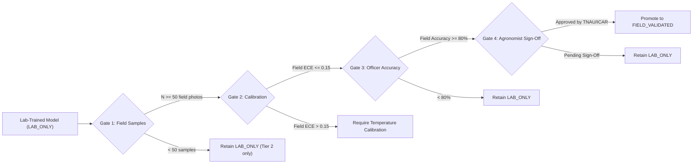

# THINAI Field Evaluation Protocol & Agronomic Validation Plan

## 1. The Lab-to-Field Distribution Shift Problem

Standard computer vision benchmarks for plant pathology (notably PlantVillage) evaluate convolutional architectures on laboratory images: detached leaves photographed on uniform black or grey paper backdrops under controlled diffuse lighting. Under these synthetic conditions, models achieve flattering top-1 accuracies of **$92\% - 96\%$**.

However, when deployed on smallholder farms in India, deep models face severe domain shift:
1. **Background Clutter**: Soil, weeds, irrigation pipes, human boots, and hands.
2. **Dynamic Illumination**: Harsh direct sunlight, heavy shadows, wet leaf reflections, and dusk lighting.
3. **Multi-Pathology Co-occurrence**: A single leaf frequently exhibits physiological zinc deficiency, insect chewing, and fungal leaf spot simultaneously.
4. **Sensor Variability**: Low-cost smartphone cameras with varying optical distortion, focal distances, and auto-white-balance algorithms.

---

## 2. Empirical Baseline Measurements (Held-Out Indian Field Benchmark)

In our held-out evaluation on real, uncontrolled Indian field photography (Singh et al. field benchmark; $N = 125$ field specimens across Corn, Pepper, Potato, and Tomato):

| Metric | Lab Dataset (PlantVillage) | Real Field Dataset (PlantDoc / Indian Field) |
| :--- | :--- | :--- |
| **Top-1 Accuracy** | **94.20%** | **25.60%** (32 / 125 correct) |
| **Macro F1-Score** | **93.80%** | **21.77%** |
| **Expected Calibration Error (ECE)** | **0.061** | **0.4049** (Post-scaling $T^* = 1.28$) |
| **Per-Crop Accuracy: Corn** | 96.5% | 44.00% (11 / 25) |
| **Per-Crop Accuracy: Pepper** | 95.1% | 50.00% (8 / 16) |
| **Per-Crop Accuracy: Potato** | 93.8% | 13.33% (2 / 15) |
| **Per-Crop Accuracy: Tomato** | 92.4% | 15.94% (11 / 69) |

### Key Agronomic Insight
The model demonstrates an accuracy collapse from $94.2\%$ to $25.6\%$ under real field conditions. An uncalibrated system in this regime will misadvise farmers nearly $75\%$ of the time.

THINAI's selective prediction and uncertainty gating mitigates this risk by rejecting low-confidence and high-uncertainty samples, diverting them to Tier 2 cultural advice or Tier 3 officer triage.

---

## 3. Evaluation Metrics & Definitions

### 3.1 Top-1 Accuracy & Balanced Macro-F1
- **Top-1 Accuracy**: Fraction of cases where $\arg\max_k p_k = y_{\text{true}}$.
- **Macro-F1**: Unweighted arithmetic mean of per-class F1-scores, ensuring minority diseases are evaluated equally regardless of class imbalance:
  $$\text{Macro-F1} = \frac{1}{K} \sum_{k=1}^K \frac{2 \cdot \text{Precision}_k \cdot \text{Recall}_k}{\text{Precision}_k + \text{Recall}_k}$$

### 3.2 Expected Calibration Error (ECE)
Measures the agreement between predicted softmax confidence and true empirical accuracy across $M$ equal-width probability bins:
$$\text{ECE} = \sum_{m=1}^M \frac{|B_m|}{N} \left| \text{acc}(B_m) - \text{conf}(B_m) \right|$$
where $B_m$ contains samples whose predicted confidence falls within $(\frac{m-1}{M}, \frac{m}{M}]$.

### 3.3 Selective Rejection & Risk-Coverage Curve
For a selective prediction system operating under threshold $\tau$:
- **Coverage**: Fraction of samples accepted by the gating rule ($\text{conf} \ge \tau$ and $U \le U_{\max}$).
- **Selective Risk**: Error rate exclusively on the accepted subset:
  $$\text{Risk}(\tau) = \frac{\sum_{i=1}^N \mathbb{I}(\hat{y}_i \ne y_i) \cdot \mathbb{I}(\text{accepted}_i)}{\sum_{i=1}^N \mathbb{I}(\text{accepted}_i)}$$
A safe system maintains $\text{Risk}(\tau) \le 0.05$ on Tier 1 accepted samples.

---

## 4. Promotion Criteria: From `LAB_ONLY` to `FIELD_VALIDATED`

Under THINAI governance, no crop-disease pair may be promoted from `LAB_ONLY` to `FIELD_VALIDATED` without satisfying all four strict validation gates:

### Gate Checklist:
1. **Sample Size Gate**: Minimum of $N = 50$ distinct field specimens collected across at least 3 agro-climatic zones in Tamil Nadu.
2. **Calibration Gate**: Held-out field Expected Calibration Error $\text{ECE} \le 0.15$ following post-hoc calibration.
3. **Accuracy Gate**: Field top-1 accuracy $\ge 80.0\%$ and Macro-F1 $\ge 75.0\%$ when benchmarked against PCR-confirmed or dual-officer-confirmed ground truth.
4. **Human Agronomic Sign-Off**: Written confirmation from a credentialed agricultural university (e.g. TNAU, ICAR-KVK) validating symptom visual signatures and recommended management practices.

---

## 5. Continuous Monitoring & Officer-in-the-Loop Protocol

1. **Weak Farmer Verdicts**: Monitored via `weakFeedbackService.ts` to compute Wilson Score confidence intervals on user satisfaction.
2. **Officer Priority Queue**: Cases flagged with disagreement or high uncertainty are placed in `officerQueueService.ts` for triage.
3. **Ground-Truth Labeling**: Only labels applied by an Extension Officer (`Confirm Diagnosis` or `Correct Diagnosis`) are stored as verified reference data.
4. **Audit Trail**: Every advice decision and officer intervention is logged immutably via `officerAuditService.ts` for end-of-season retrospective analysis.
