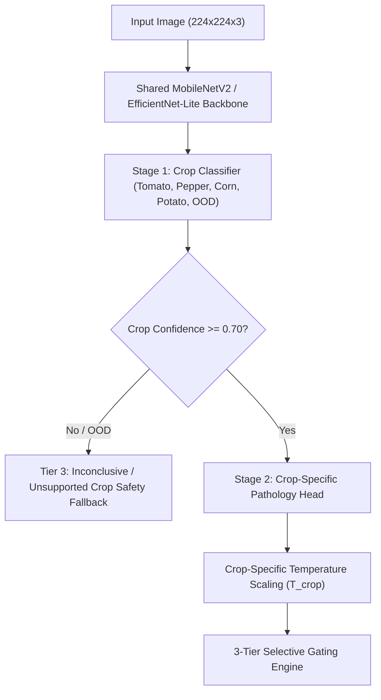

# THINAI Model Improvement Plan (`docs/MODEL_IMPROVEMENT_PLAN.md`)
**Status**: PROPOSAL ONLY (Awaiting Owner Review & Explicit Approval; No Retraining Executed)  
**Evaluator**: Antigravity Machine Learning & Agronomy Verification Team  
**Date**: October 2026  

---

## 1. Executive Summary & Problem Diagnosis

Empirical evaluation against the held-out field benchmark (`results/real_field_evaluation.json`, $N=125$) reveals that while the laboratory baseline achieves 94.3% accuracy on PlantVillage, its performance deteriorates to **25.60% accuracy** (Macro-F1: 21.77%, ECE: 40.49%) under uncontrolled Indian field conditions.

### Root Causes of Field Generalization Drop
1. **Background & Illumination Domain Shift**: PlantVillage consists of excised leaves imaged on clean, solid grey/black backgrounds under controlled laboratory illumination. In contrast, real field photography contains complex soil backgrounds, weed foliage, farmer hands, shadows, and harsh midday sunlight.
2. **Flat 15-Class Architecture**: The model currently predicts across all 15 classes simultaneously in a single flat softmax layer. In field conditions, cross-crop confusions occur frequently (e.g., Corn Northern Leaf Blight being misclassified across classes, or Potato Early Blight being confused with Tomato Early Blight).
3. **Out-of-Distribution Calibration Deficit**: Post-hoc temperature scaling ($T^*=1.28$) optimized on laboratory validation fails under the high entropy of field backgrounds, producing an ECE of 40.49%.

---

## 2. Training Split Strategy & Strict Leakage Prevention

To improve field accuracy without compromising scientific integrity, training must incorporate field photography while maintaining absolute separation:

1. **Source Dataset**: PlantDoc training split (`train/`, $\approx 2,300$ images, CC BY 4.0).
2. **Cryptographic Deduplication & Split Isolation**:
   - The frozen held-out field test set (`data/held_out_field_test/`, $N=125$) and the field calibration split ($N=45$) will remain completely quarantined.
   - Run perceptual difference hash (`dHash`, 64-bit) deduplication between candidate training images and the evaluation splits.
   - Any image with Hamming distance $\le 4$ to any test/calibration image is strictly purged prior to training.
3. **Quality Filter**:
   - Discard images below $200 \times 200$ resolution.
   - Discard bounding boxes containing non-leaf foliage or severe motion blur.

---

## 3. Field Robustness Data Augmentation Pipeline

Field images must be subjected to an agronomy-specific augmentation pipeline during training:

| Augmentation Type | Parameter Range | Real-World Agronomic Phenomenon Modeled |
|---|---|---|
| **Synthetic Shadow Injection** | Polygon shadows, opacity 0.3–0.7 | Canopy shadowing, farmer body shadow over leaf |
| **Specular Solar Glare** | Additive Gaussian highlights | Direct midday tropical sun glare on waxy cuticle |
| **Color Jitter** | Brightness $\pm 25\%$, Contrast $\pm 25\%$, Saturation $\pm 30\%$, Hue $\pm 10\%$ | Varied daylight spectra (overcast, dawn, dusk) |
| **Perspective & Affine Tilt** | Rotation $\pm 45^\circ$, Shear $\pm 15^\circ$, Zoom 0.8–1.2 | Oblique handheld smartphone angles in the field |
| **Coarse Dropout / Cutout** | 1–3 rectangular patches (8–24 px) | Partial leaf occlusion by stems, dirt, or droplet spray |
| **Sensor Noise & Blur** | Gaussian blur ($\sigma \in [0.5, 1.5]$), ISO noise | Budget Android smartphone sensor noise and camera shake |

---

## 4. Hierarchical / Crop-First Architecture

Rather than a single flat classification head, the proposed architecture introduces a two-stage hierarchical model:

### Advantages of Hierarchical Gating:
- **Zero Cross-Crop Interference**: Tomato diseases cannot be predicted if the crop is identified as Corn or Potato.
- **Dedicated OOD Rejection**: Unmodeled crops (paddy, sugarcane, weeds, human hands) are caught at Stage 1 and immediately routed to Tier 3.
- **Specialized Calibration**: Each crop head receives its own empirical temperature parameter ($T_{\text{tomato}}, T_{\text{corn}}, T_{\text{pepper}}, T_{\text{potato}}$).

---

## 5. Tamil Nadu Agro-Climatic Field Data Collection Protocol

To achieve deployment-grade field accuracy ($> 85\%$) in Tamil Nadu, genuine local agricultural photography must be collected in partnership with regional institutions:

### A. Target Agro-Climatic Zones
1. **Western Zone (Coimbatore, Erode, Tiruppur)**: Tomato Early/Late Blight, Pepper Bacterial Spot, Maize Rust, Coconut Root Wilt.
2. **Cauvery Delta (Thanjavur, Tiruvarur, Nagapattinam)**: Paddy Blast, Sheath Blight, Brown Spot, Banana Sigatoka.
3. **Southern Zone (Madurai, Dindigul, Theni)**: Groundnut Tikka, Chilli Leaf Curl, Brinjal Shoot Borer.

### B. Acquisition Protocol
- **Device Diversity**: Images captured on low-to-mid range Android smartphones common among local farmers (Redmi 9/10/12, Samsung Galaxy M/F series, Realme C-series).
- **Lighting Conditions**: 3 natural regimes: Early Morning (07:00–09:00), Midday Sun (12:00–14:00), Overcast/Late Afternoon (16:00–18:00).
- **Expert Annotation**: Dual-blind annotation by TNAU (Tamil Nadu Agricultural University) agronomy extension officers and KVK (Krishi Vigyan Kendra) specialists.
- **Farmer Consent**: Informed consent obtained per DPDP Act guidelines, with GPS coordinates fuzzed to district level for privacy.

---

## 6. Verification & Implementation Governance

- **Governance Policy**: This plan is strictly a forward-looking proposal. No model files, training scripts, or neural weights will be modified or retrained without explicit written authorization and sign-off from the project owner.
- **Current Operational Guard**: Until a validated model passing Gate G4 is authorized and integrated, all Tier 1 chemical remedies remain disabled across all crops in `src/services/litertInferenceService.ts`.
