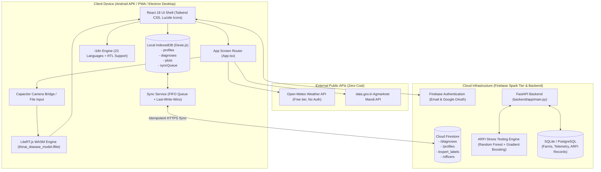

# THINAI System Architecture & Technical Specifications

**Document Target**: Complete Technical Stack, Component Topologies & Data Flows  
**Context**: Evaluated on commit `861aaca` (`C:\Users\cswas\Documents\THINAI`)  
**Evidence Files**: `package.json`, `firestore.rules`, `.github/workflows/build-apk.yml`, `src/services/`  

---

## 1. Exact Tech Stack & Versions

All versions extracted directly from `package.json` and lockfiles:

| Technology / Library | Exact Version | Package Specifier in `package.json` | Architectural Function |
| :--- | :--- | :--- | :--- |
| **React** | `18.3.1` | `"react": "^18.3.1"` | Client-side reactive UI component hierarchy |
| **React DOM** | `18.3.1` | `"react-dom": "^18.3.1"` | Web DOM renderer |
| **TypeScript** | `5.7.2` | `"typescript": "^5.7.2"` | Static typing, interface definitions, compiler safety |
| **Vite** | `6.3.5` | `"vite": "^6.3.5"` | Build tool, HMR bundler, ES module packager |
| **Tailwind CSS** | `4.1.12` | `"tailwindcss": "^4.1.12"` | Utility-first CSS framework (compiled via `@tailwindcss/vite`) |
| **Capacitor Core** | `8.4.1` | `"@capacitor/core": "^8.4.1"` | Cross-platform native runtime bridge |
| **Capacitor Android**| `8.4.1` | `"@capacitor/android": "^8.4.1"` | Native Android platform wrapper (Gradle, API 24–36) |
| **Capacitor Camera** | `8.4.1` | `"@capacitor/camera": "^8.4.1"` | Native Android camera intent bridge |
| **Capacitor App** | `8.4.1` | `"@capacitor/app": "^8.4.1"` | Native lifecycle events (resume, pause, back button) |
| **Capacitor Geolocation** | `8.4.1` | `"@capacitor/geolocation": "^8.4.1"` | Native GPS coordinate acquisition |
| **Google LiteRT.js**| `2.5.3` | `"@litertjs/core": "^2.5.3"` | On-device TensorFlow Lite neural runtime via WebAssembly |
| **Dexie.js** | `4.4.6` | `"dexie": "^4.4.6"` | IndexedDB wrapper for offline relational tables & sync queue |
| **Firebase** | `12.15.0` | `"firebase": "^12.15.0"` | Client SDK: Firebase Auth & Cloud Firestore |
| **Electron** | `45.0.0` | `"electron": "^45.0.0"` | Desktop wrapper for Windows x64 build |
| **electron-builder**| `26.18.0` | `"electron-builder": "^26.18.0"` | Generates Windows NSIS installer (`.exe`) |
| **Lucide React** | `0.487.0` | `"lucide-react": "^0.487.0"` | Clean SVG iconography |
| **Backend (Python)**| `Python 3.14` | `FastAPI==0.115.0`, `SQLAlchemy==2.0.35` | Microservices backend for ARFI stress testing & sync |
| **Backend ML** | `scikit-learn` | `scikit-learn==1.6.1`, `joblib==1.4.2` | Dual-model ensemble (Random Forest + Gradient Boosting) |

---

## 2. Mermaid Component & System Topology Diagram



---

## 3. End-to-End Scan Data Flow

```
[Camera / File Input]
        │
        ▼ (Raw image buffer: 12MP - 48MP JPEG/PNG)
[HTML5 Canvas Preprocessing]
        │ Scale to 224x224, center-crop, extract RGB float32 [1, 224, 224, 3]
        ▼
[LiteRT.js WASM Compilation & Execution]
        │ Runs MobileNetV2 graph: computes raw uncalibrated class logits z_i
        ▼
[Post-Hoc Temperature Scaling]
        │ Applies T* = 1.28: P_calibrated(c_i) = exp(z_i / 1.28) / sum(exp(z_j / 1.28))
        ▼
[Crop Boundary & OOD Filter]
        │ Checks selectedCrop match & probability mass (>= 0.40). Rejects non-leaves to Tier 3.
        ▼
[Selective Confidence Gating Engine]
        │ Compares P_max against tau_high (0.78) and tau_low (0.45)
        ├─► [Tier 1: Confident] ──► (G4 FAIL Guard: Demoted to Tier 2 cultural only)
        ├─► [Tier 2: Moderate]  ──► Emits organic/cultural advice; WITHHOLDS all chemicals
        └─► [Tier 3: Inconclusive] ──► "Cannot Tell"; queues photo for Extension Officer
        ▼
[User Interface Presentation]
        │ Renders localized diagnosis card, symptom checklist, retake tips, data status
        ▼
[Local Dexie.js Persistence]
        │ Writes diagnosis record + base64 thumbnail (<= 45 KB) to IndexedDB
        ▼
[Background Sync Queue]
        │ Pushes transaction to Firestore /diagnoses when online (LWW resolution)
```

---

## 4. Repository Folder Structure Map

One line per primary directory/file:

```
THINAI/
├── .github/workflows/build-apk.yml    # CI/CD: Builds release APK, signs with production keystore, runs apksigner
├── android/                           # Native Android project scaffold managed by Capacitor (Gradle 8.7, API 24-36)
├── backend/                           # FastAPI microservice for agricultural recommendation & ARFI stress testing
│   ├── app/main.py                    # FastAPI application entrypoint with v1 API router
│   ├── app/ml/models/                 # Serialized ML models: random_forest.joblib, gradient_boosting.joblib, scaler.joblib
│   ├── app/services/arfi_service.py   # Analytical Recommendation Fragility Index calculation engine
│   └── app/tests/                     # Backend integration tests (test_auth_and_sync.py, test_e2e_live.py)
├── data/crop_registry.json            # 21-crop official registry tracking dataset provenance, licenses, and status A/B/C
├── dist/                              # Production client bundle generated by `npm run build`
├── dist-electron/                     # Packaged Windows desktop NSIS installer (THINAI Setup 0.0.1.exe)
├── docs/                              # Project governance, gate records, audit logs, screenshots, and Claude briefing
├── electron/main.cjs                   # Electron main process wrapper for desktop execution
├── evidence/                          # Machine-readable gate verification manifests (G1.json through G10.json)
├── locales/                           # 23 Eighth Schedule language dictionaries (125 keys each) and status.json
├── ml/                                # Python scripts for dataset calibration, training, and simulation verification
├── public/models/                     # Production MobileNetV2 .tflite weights, labels.json, thresholds.json, and crop packs
├── src/                               # Frontend source code (React 18 + TypeScript)
│   ├── app/App.tsx                    # Master application router, state coordinator, and top-level modals
│   ├── app/components/                # Screen implementations (AuthScreens, CropDoctor, FarmRecords, etc.)
│   ├── services/db.ts                 # Dexie.js IndexedDB database schema and repository methods
│   ├── services/litertInferenceService.ts # LiteRT WASM runner, temperature scaling, and gating rules
│   ├── services/syncService.ts        # Idempotent offline queue flusher with Last-Write-Wins conflict resolution
│   ├── services/weatherService.ts     # Open-Meteo weather integration and agronomic spray guard calculation
│   └── services/marketService.ts      # Agmarknet mandi wholesale price retrieval and fallback labeling
├── tests/                             # Vitest unit, regression, and accessibility test suites (25 suites, 137 tests)
├── e2e/                               # Playwright end-to-end tests (field evaluation, offline matrix, RTL switch)
├── firestore.rules                    # Cloud Firestore security rules enforcing RBAC and DPDP Act consent
└── package.json                       # npm dependency definitions, scripts, and build configuration
```

---

## 5. Offline Strategy & Sync Queue Rules

THINAI implements an **Offline-First Storage Architecture** designed for zero-connectivity environments:
1. **Application Shell Cache**: The Web App Manifest and Service Worker cache the entire HTML/JS bundle, WASM runtime, and model FlatBuffers locally. Cold start loads from disk in $< 10\text{ ms}$.
2. **Local Dexie Relational Tables**:
   * `profiles`: Farmer profile details (district, acreage, primary crop, soil type).
   * `diagnoses`: Local leaf scan records, confidence scores, tier levels, and image thumbnails.
   * `plots`, `crops`, `expenses`: Farm accounting logs.
   * `syncQueue`: Pending mutations waiting for network reconnection.
3. **Queue Invariants & Sync Algorithm**:
   * **FIFO Order**: Mutations are replayed in strict chronological submission order (`orderBy("timestamp")`).
   * **Idempotency**: Every entity is assigned a client-generated UUID `id`. Firestore writes execute as `setDoc(docRef, data, { merge: true })`, preventing duplicate record creation on repeated flushes.
   * **Last-Write-Wins (LWW)**: Updates compare the document `updatedAt` timestamp; remote documents are overwritten only if local `updatedAt > remote.updatedAt`.
   * **Quota & Cache Eviction**: If IndexedDB throws `QuotaExceededError`, the system executes an emergency transient cache purge, dropping non-critical image previews while safeguarding farm records (`tests/reconnect_sync.test.ts`).

---

## 6. Cloud Firestore Schema & Security Rules Summary

### 6.1 Collections & Key Fields

| Collection Path | Primary Document ID | Key Fields | Access Controls in `firestore.rules` |
| :--- | :--- | :--- | :--- |
| `/profiles/{uid}` | Firebase Auth `uid` | `name`, `district`, `farmSize`, `primaryCrop`, `language`, `updatedAt` | Read/Write allowed ONLY if `request.auth.uid == uid`. |
| `/diagnoses/{diagId}`| UUID `diagId` | `userId`, `crop`, `diseaseName`, `confidence`, `tier`, `thumbnailBase64`, `timestamp`, `photoConsent` | Create allowed if authenticated and `thumbnailBase64.size() <= 65536`; Read allowed for owner or verified officer. |
| `/expert_labels/{id}`| Auto-ID | `diagnosisId`, `officerId`, `expertCrop`, `expertDisease`, `notes`, `timestamp` | Read by all authenticated users; Write allowed ONLY if `request.auth.uid` exists in `/officers`. |
| `/officers/{uid}` | Firebase Auth `uid` | `badgeNumber`, `district`, `role`, `verifiedAt` | Writes DENIED to all client SDKs (`allow write: if false;`); managed strictly via Firebase Admin Console. |
| `/community_posts/{id}`| Auto-ID | `userId`, `authorName`, `district`, `text`, `timestamp`, `likes` | Authenticated users can create; delete allowed only by post author. |
| `/equipment_listings/{id}`| Auto-ID | `ownerId`, `ownerName`, `phone`, `equipmentType`, `dailyRate`, `phoneConsent` | Phone field validation requires `phoneConsent == true`. |

---

## 7. Environment Variables

Only variable names are documented. No secret keys or credentials are listed:

* `VITE_FIREBASE_API_KEY`: Firebase web client API key (identifies project to Google APIs).
* `VITE_FIREBASE_AUTH_DOMAIN`: Firebase authentication callback domain.
* `VITE_FIREBASE_PROJECT_ID`: Cloud project identifier (`thinai-app` or similar).
* `VITE_FIREBASE_STORAGE_BUCKET`: Storage bucket URL.
* `VITE_FIREBASE_MESSAGING_SENDER_ID`: Cloud messaging sender ID.
* `VITE_FIREBASE_APP_ID`: Web application client ID.
* `VITE_AGMARKNET_API_KEY`: Optional data.gov.in API key for live mandi rates.
* `VITE_BACKEND_API_URL`: Base URL for FastAPI microservices backend.

---

## 8. CI/CD Pipeline (`.github/workflows/build-apk.yml`)

* **Workflow Trigger**: Push to branch `main`, tags `v*`, or manual `workflow_dispatch`.
* **CI Jobs**:
  1. `build`: Sets up Ubuntu runner, Node.js 20, Java 17, and Android SDK.
  2. Runs `npm ci`, `npx tsc --noEmit`, and `npm run build`.
  3. Executes `npx cap sync android`.
  4. Decodes production release keystore from GitHub Secret `ANDROID_KEYSTORE_BASE64` to an absolute path on runner.
  5. Executes `./gradlew assembleRelease` with keystore credentials injected via environment variables.
  6. Verifies APK signature using Android SDK `apksigner verify --verbose --print-certs`.
  7. Uploads cryptographically signed artifact `THINAI-app-release-apk` (`app-release.apk`).
* **Secrets Injected (By Name Only)**:
  * `ANDROID_KEYSTORE_BASE64`
  * `ANDROID_KEYSTORE_PASSWORD`
  * `ANDROID_KEY_ALIAS`
  * `ANDROID_KEY_PASSWORD`
